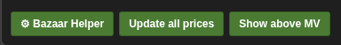
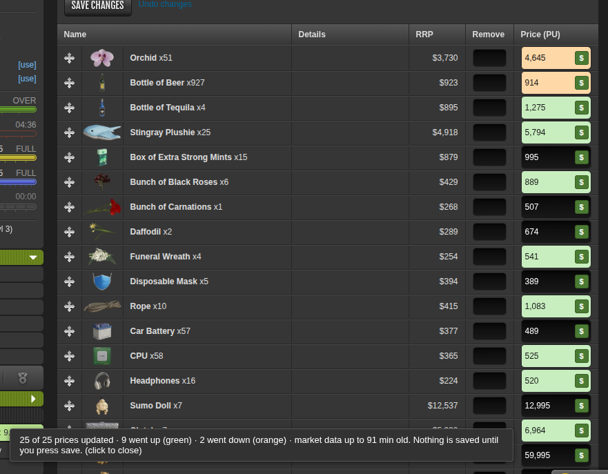
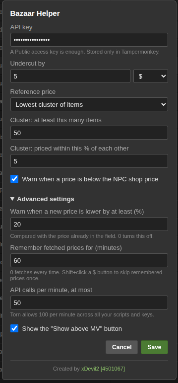

# Torn Bazaar Helper

A Tampermonkey userscript for [Torn](https://www.torn.com) that takes the tedious part out of pricing your bazaar. It adds one-click buttons for quantity and price on the **Add Items** and **Manage Items** pages, using live Item Market prices from the Torn API.

Created by **xDevil2 [4501067]** ([profile](https://www.torn.com/profiles.php?XID=4501067)).

## What it does

- **Max** button next to the quantity box on Add Items: fills in everything you own of that item.
- **$** button in every price field (Add Items and Manage Items): looks up the Item Market and fills in a price just below the competition.
- **Update all prices** button on Manage Items: reprices every item on the page in one go.
- **Two pricing modes:** undercut the single lowest price, or undercut the lowest *cluster*: the first price with a meaningful number of items for sale, so a handful of cheap items doesn't drag your price down.
- **Show above MV** button: colours in blue every price that is above the item's Torn market value.
- **NPC shop warning:** refuses to set a price below what NPC shops pay for the item, and warns if you type one by hand.
- **Big drop warning:** flags a new price that is much lower than the one it replaces.
- **Remembers prices** for a configurable time, so repeated clicks don't spend API calls.
- **Respects the API limit:** you choose how many calls per minute the script may use, and it warns on the page when you get close.

The script only fills in fields. It never saves, lists, or buys anything; you always press Torn's own button to confirm.

## Installation

1. Install the [Tampermonkey](https://www.tampermonkey.net/) browser extension.
2. On Chrome or Edge, open `chrome://extensions`, go to Tampermonkey's details, and turn on **Allow user scripts** (or Developer mode on older versions). Without it the script will not run.
3. Click the Tampermonkey icon, choose **Create a new script**, delete the template, paste the contents of `bazaar-helper.user.js`, and save with Ctrl+S.
4. Open your bazaar in Torn and reload the page. A green **⚙ Bazaar Helper** button appears in the bottom-left corner.
5. Click it, paste your API key, and save.

### API key

Create a key in Torn under **Settings → API Keys**. A **Public** access key is enough. The key is stored only in Tampermonkey's storage on your computer and is sent only to `api.torn.com`.

## Using it

The script adds a row of buttons to the bottom-left corner of the bazaar page:



| Page | Button | What happens |
|---|---|---|
| Add Items | **Max** | Fills the quantity with everything you own (ticks the box for single items). |
| Add Items, Manage Items | **$** | Fetches market listings and fills in the price. Shift+click ignores remembered prices and fetches fresh ones. |
| Add Items, Manage Items | **Show above MV** | Colours in blue every filled-in price that is above the item's market value. Hover a price to see the market value and how far above or below it you are. Click again (**Hide above MV**) to remove the blue. |
| Manage Items | **Update all prices** | Prices every item on the page one after another, showing progress. Click again to stop. Shift+click forces fresh prices. |

After each **$** click a short message shows the reference price and the price that was set, for example `$868,000 (cluster of 950 items) → $867,999`. A field outlined in red means a warning applies to it.

**Update all prices** only sees the rows that are loaded on the page when you click. If your bazaar list loads more rows as you scroll, scroll to the bottom first. The summary at the end reports how many prices were updated, flagged, or skipped, and stays on screen until you click it.



After a **$** click or a mass update, fields are coloured by what happened: light green where the price went up, light orange where it went down, and a red outline where it dropped by your warning percentage or more, or was not priced because NPC shops pay more.

## Settings

Open them with the **⚙ Bazaar Helper** button or from the Tampermonkey menu.



| Setting | Default | Meaning |
|---|---|---|
| API key | (empty) | Your Torn API key. |
| Undercut by | $1 | How far below the reference price to go, as a dollar amount or a percentage. |
| Reference price | Lowest price | **Lowest price**, or **Lowest cluster of items**. |
| Cluster: at least this many items | 15 | How many items must be for sale around one price for it to count as a cluster. |
| Cluster: priced within this % of each other | 2 | How close together those items must be priced, measured from the cheapest one in the group. |
| Warn when a price is below the NPC shop price | on | See "Warnings" below. |
| Warn when a new price is lower by at least (%) | 20 | Compared with the price already in the field. 0 turns it off. |
| Remember fetched prices for (minutes) | 30 | How long market prices are reused. 0 fetches every time. |
| Show the "Show above MV" button | on | Turn off to remove that button from the page. |
| API calls per minute, at most | 20 | This script's share of Torn's limit of 100 calls per minute. |

## How the price is chosen

Prices come from the **Item Market** through the official Torn API. The API does not expose other players' bazaar listings, so those are not considered.

The API's market data is a shared snapshot that Torn refreshes about once an hour, so prices can lag the live market by an hour or more. The message after each **$** click shows how old the data is; check fast-moving items by hand.

- **Lowest price:** the reference price is the cheapest one on the market.
- **Lowest cluster of items:** starting from the cheapest price, the script looks for the first price where the items for sale within *X%* of it add up to at least *N* items. That price is the reference. If no such group exists, it falls back to the cheapest price.

  Example with 15 items within 5%: with 12 items at 800, 253 at 990 and 11 at 994, the 12 items at 800 are too few, so they are skipped and the reference is 990. Had there been 18 items at 800, the reference would be 800.

The undercut is then subtracted from the reference price. The result is rounded down and never goes below $1.

## Warnings

- **NPC shop price.** If the calculated price is below what NPC shops pay for the item, the **$** button does not fill it in and tells you to sell to a shop instead. Typing such a price by hand shows a warning but does not stop you.
- **Big drop.** If the new price is lower than the previous one by at least the configured percentage, the price is still filled in, but the field is outlined in red and a warning is shown so you can check before saving.
- **API limit.** From 80% of your per-minute allowance, an amber notice appears above the settings button; it turns red when the limit is reached. The script then refuses further calls until earlier ones age out. **Update all prices** waits automatically.

The script counts only its own API calls. It cannot see calls made by other scripts or tools using your keys, so leave room for those.

## Torn's rules

Torn allows scripts that display information and fill in fields, and forbids scripts that perform game actions for you. This script reads from the official API and fills in input boxes; every listing or price change is still confirmed by you with Torn's own button. If you want certainty about the bulk button, ask in Torn's scripting forum.

## Troubleshooting

- **No ⚙ Bazaar Helper button:** the script is not running. Check that it is enabled in Tampermonkey and that "Allow user scripts" is on, then reload.
- **Settings button shows, but no Max / $ buttons:** Torn's page layout may have changed. Please report it with the HTML of one item row.
- **"API error: …":** the message comes from Torn, usually a wrong or deleted key.
- **A price looks out of date:** Torn's API refreshes its Item Market data only about once an hour, so offers posted since then are invisible to the script. Every message ends with the age of the data ("market data from 69 min ago"). If the script is also reusing a remembered price, Shift+click the **$** button to fetch again.

## Development and tests

The whole script is the single file `bazaar-helper.user.js`. The tests need Node.js 18 or newer and `make`; there are no other dependencies.

```
make test                     # run the tests, then print a price table (cluster of 15 items within 5%)
make test UNITS=50 PCT=1.5    # the same with your own cluster size (items) and percentage
make test UNDERCUT=2 UNIT=%   # undercut by 2% instead of $1
make table UNITS=30 PCT=1     # only the table
make fetch KEY=yourPublicKey ITEMS="206 274"   # save fresh market listings as fixtures
```

- `tests/pricing.test.mjs` holds hand-written pricing cases and also runs every saved market snapshot in `tests/fixtures/`.
- The tests load the pricing function directly from the userscript (the block between `// <pricing>` and `// </pricing>`), so there is no second copy to keep in sync. Keep that block self-contained.
- `make fetch` saves real Item Market listings for the given item IDs. The expected prices it writes are whatever the script computes at that moment, so review them: they record current behaviour, not proven-correct prices.
- The table shows, for every saved item, the cheapest listings and the price the script would set in both modes.

## Licence

Released under the [GNU General Public License v3.0](LICENSE). You may use, modify and redistribute the script, provided that versions you share stay open source under the same licence.

## Author and donations

Created by **xDevil2 [4501067]**.

The script is free to use. If you find it useful, donations are welcome: send cash or items in-game to [xDevil2 [4501067]](https://www.torn.com/profiles.php?XID=4501067). Thank you!
